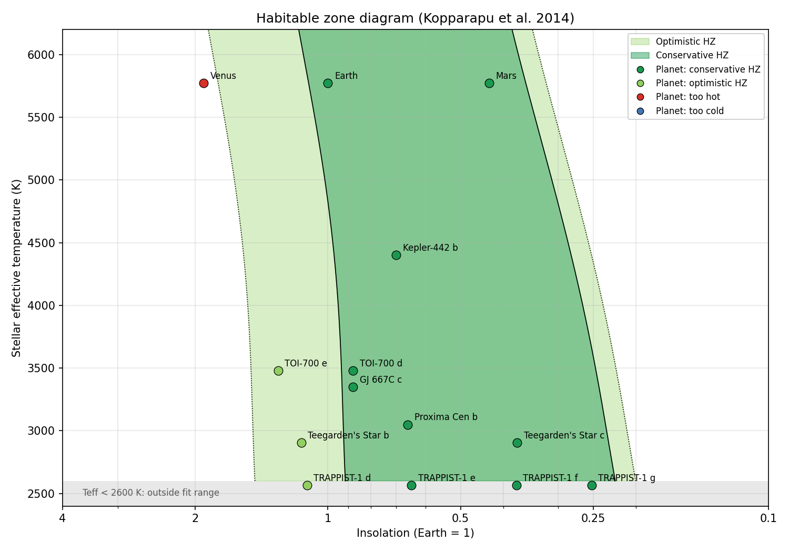
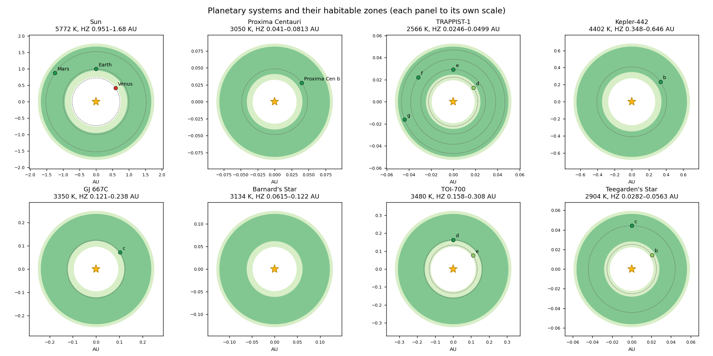
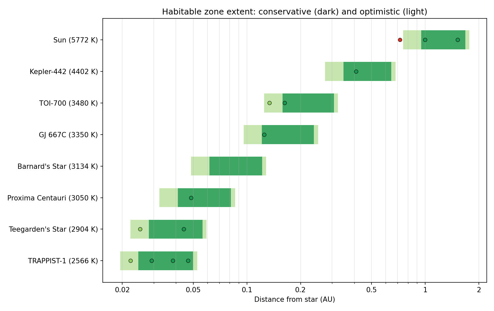

#  Habitable Zone Analysis


Python tools to compute the **habitable zones (HZ)** of main-sequence stars using the climate-model fits of **Kopparapu et al. (2014)**, and to assess where **known exoplanets** sit within them. Proxima Centauri is the main case study, compared with TRAPPIST-1, TOI-700, Teegarden's Star and other nearby systems.


*Stellar temperature vs. insolation for 14 planets. Dark green: conservative HZ. Light green: optimistic HZ.*

---

## Features

- **Conservative and optimistic HZ limits:** runaway greenhouse → maximum greenhouse, and recent Venus → early Mars
- **Planet-mass dependent inner edge** for 0.1, 1 and 5 Earth-mass planets
- **Planet assessment:** insolation, equilibrium temperature, orbital period and the **HZ distance** metric (Kane & Gelino 2012), plus a classification (conservative HZ / optimistic HZ / too hot / too cold)
- **Orbital periods at the HZ edges** from Kepler's third law, useful for planning transit or radial-velocity searches
- **Validity checks:** warns when a star is outside the 2600–7200 K range of the fits
- **Editable catalogues** of stars and planets in CSV, each value with its literature source
- **Three figures:** the HZ diagram, per-system orbit maps, and a comparison of HZ extents
- **Tests** that check the code against published values

## Method

The effective stellar flux at each HZ boundary is

$$S_{\rm eff} = S_{\rm eff,\odot} + aT_\star + bT_\star^2 + cT_\star^3 + dT_\star^4, \qquad T_\star = T_{\rm eff} - 5780~{\rm K}$$

and the boundary lies at

$$d = \sqrt{\frac{L_\star / L_\odot}{S_{\rm eff}}}~{\rm AU}.$$

| Boundary | Physical meaning | $S_{\rm eff,\odot}$ |
|---|---|---|
| Recent Venus | Venus has had no surface water for at least 1 Gyr | 1.776 |
| Runaway greenhouse | Oceans evaporate completely | 1.107 |
| Maximum greenhouse | CO₂ can no longer warm the surface above freezing | 0.356 |
| Early Mars | Mars appears to have had surface water 3.8 Gyr ago | 0.320 |

For the Sun this gives a conservative HZ of **0.95–1.68 AU** and an optimistic HZ of **0.75–1.77 AU**, matching Kopparapu et al. (2014).

## Results

| Planet | Insolation (S⊕) | T_eq (K) | HZ distance | Location |
|---|---|---|---|---|
| Proxima Cen b | 0.66 | 230 | −0.63 | Conservative HZ |
| TRAPPIST-1 d | 1.12 | 262 | −1.19 | Optimistic HZ |
| TRAPPIST-1 e | 0.65 | 228 | −0.63 | Conservative HZ |
| TRAPPIST-1 f | 0.37 | 199 | +0.10 | Conservative HZ |
| TRAPPIST-1 g | 0.25 | 181 | +0.76 | Conservative HZ |
| Kepler-442 b | 0.70 | 233 | −0.59 | Conservative HZ |
| GJ 667C c | 0.88 | 247 | −0.94 | Conservative HZ |
| TOI-700 e | 1.30 | 272 | −1.32 | Optimistic HZ |
| TOI-700 d | 0.88 | 247 | −0.94 | Conservative HZ |
| Teegarden's Star b | 1.15 | 264 | −1.21 | Optimistic HZ |
| Teegarden's Star c | 0.37 | 199 | +0.15 | Conservative HZ |

*T_eq assumes a Bond albedo of 0.3 and full heat redistribution. TRAPPIST-1 (2566 K) lies just below the 2600 K limit of the fits, so its values are extrapolated.*



Because M-dwarf habitable zones are tens of times closer in than the Sun's, each system above is drawn to its own scale. The comparison below puts them all on one logarithmic axis:



## Installation

```bash
git clone https://github.com/Jiqbal-astro/Habitable-Zone-Analysis.git
cd Habitable-Zone-Analysis
pip install -r requirements.txt
```

## Usage

**Run the full catalogue.** This prints the tables and saves CSV files and figures to `output/`:

```bash
python habitable_zone.py
```

**Analyse any star.** You can optionally test planets at given distances:

```bash
python habitable_zone.py --teff 3500 --lum 0.02 --mass 0.4 --name "My Star" --planet-a 0.1 0.15
```

```
Habitable zone of My Star (Teff = 3500 K, L = 0.02 L_sun, M = 0.4 M_sun)

  optimistic inner       0.1157 AU   P =    22.72 d   T_eq =   282 K
  conservative inner     0.1465 AU   P =    32.39 d   T_eq =   250 K
  conservative outer     0.2846 AU   P =    87.67 d   T_eq =   180 K
  optimistic outer       0.3002 AU   P =    94.97 d   T_eq =   175 K

  planet at 0.1 AU: S = 2.00 S_earth, T_eq = 303 K, HZD = -1.67, too hot
  planet at 0.15 AU: S = 0.89 S_earth, T_eq = 247 K, HZD = -0.95, conservative HZ
```

**Use it as a library:**

```python
import habitable_zone as hz

hz.hz_limits(teff=3050, luminosity=0.00155)           # Proxima Centauri
hz.hz_limits(teff=3050, luminosity=0.00155, planet_mass=5.0)
hz.equilibrium_temperature(luminosity=0.00155, a=0.0485)
```

**Add your own stars or planets** by adding rows to `data/stars.csv` and `data/planets.csv`.

| Option | Default | Description |
|---|---|---|
| `-o, --output` | `output` | Output directory |
| `--stars`, `--planets` | `data/*.csv` | Catalogue files |
| `--planet-mass` | `1` | Planet mass for the inner edge: `0.1`, `1` or `5` Earth masses |
| `--albedo` | `0.3` | Bond albedo for equilibrium temperatures |
| `--teff`, `--lum`, `--mass`, `--name` | | Analyse a single star instead of the catalogue |
| `--planet-a` | | Semi-major axes (AU) of planets to assess around that star |

**Run the tests:**

```bash
pip install pytest
pytest
```

The notebook [`HZ_analysis.ipynb`](HZ_analysis.ipynb) walks through the full analysis step by step.

## Limitations

- The fits assume Earth-like planets with N₂–H₂O–CO₂ atmospheres around main-sequence stars with 2600 K ≤ T_eff ≤ 7200 K.
- The HZ is calculated for present-day luminosity. M dwarfs are much brighter during their pre-main-sequence phase, so planets now in the HZ may have lost their water early on.
- Being in the HZ is not the same as being habitable. Tidal locking, stellar flares and atmospheric escape around active M dwarfs are not included.
- Planet orbits are treated as circular.

## Repository structure

```
├── habitable_zone.py        # module + command-line tool
├── HZ_analysis.ipynb        # step-by-step walkthrough
├── data/
│   ├── stars.csv            # stellar parameters with sources
│   └── planets.csv          # planet semi-major axes with sources
├── figures/                 # figures used in this README
├── tests/                   # checks against published values
├── requirements.txt
└── LICENSE
```

## References

- Kopparapu, R. K. et al. (2013), *Habitable Zones around Main-sequence Stars: New Estimates*, ApJ, 765, 131
- Kopparapu, R. K. et al. (2014), *Habitable Zones around Main-sequence Stars: Dependence on Planetary Mass*, ApJL, 787, L29
- Kane, S. R. & Gelino, D. M. (2012), *The Habitable Zone Gallery*, PASP, 124, 323
- Anglada-Escudé, G. et al. (2016), *A terrestrial planet candidate in a temperate orbit around Proxima Centauri*, Nature, 536, 437
- Agol, E. et al. (2021), *Refining the transit-timing and photometric analysis of TRAPPIST-1*, PSJ, 2, 1
- Gilbert, E. A. et al. (2020, 2023), TOI-700 system papers, AJ 160, 116 and ApJL 944, L35
- Zechmeister, M. et al. (2019), *The CARMENES search for exoplanets around M dwarfs: Two temperate Earth-mass planet candidates around Teegarden's Star*, A&A, 627, A49
- Torres, G. et al. (2015), *Validation of 12 small Kepler transiting planets in the habitable zone*, ApJ, 800, 99
- Anglada-Escudé, G. et al. (2013), *A dynamically-packed planetary system around GJ 667C*, A&A, 556, A126

## Author

**Javed Iqbal**: astronomy researcher working on exoplanets and variable stars
[GitHub](https://github.com/Jiqbal-astro) · [Website](https://jiqbal-astro.github.io) · [LinkedIn](https://www.linkedin.com/in/jiqbal-astro/)

Released under the [MIT License](LICENSE).
